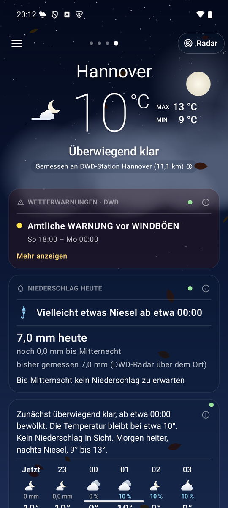

<!--
  Nimbus - docs/index.md
  Project page on GitHub Pages: what Nimbus is, where to get it, the privacy policy.

    Copyright (C) 2026 Thorsten Schnebeck <thorsten.schnebeck@gmx.net>
    Produced by Thorsten Schnebeck - the idea, the decisions, the testing.
    Written by Anthropic Claude Opus 5.5 - AI generated content.

    Free software under the GNU General Public License, version 3 or later.
    There is no warranty, to the extent permitted by law. The full text is in
    LICENSES/GPL-3.0-or-later.txt.

  SPDX-FileCopyrightText: (C) 2026 Thorsten Schnebeck <thorsten.schnebeck@gmx.net>
  SPDX-FileContributor: Anthropic Claude Opus 5.5 (AI generated content)
  SPDX-License-Identifier: GPL-3.0-or-later
-->

[English](index.en.md)

# Nimbus – Wetter für Deutschland und Europa

Nimbus zeigt das Wetter mit kleinen Animationen des Himmels: Messwerte der nächsten Wetterstation,
die Vorhersage des feinsten Modells für den Ort, das Regenradar von DWD und KNMI, Pollenflug, Pegel
und Badegewässer. Keine Werbung, kein Konto, keine Google-Dienste – freie Software (GPL-3.0).

- **Herunterladen:** [neueste Version auf GitHub](https://github.com/schnebeck/nimbus-weather/releases/latest)
- **Beschreibung und Funktionen:** [README](https://github.com/schnebeck/nimbus-weather/blob/main/README.md)
- **Hintergründe:** [Stationsnetze](https://github.com/schnebeck/nimbus-weather/blob/main/docs/STATIONS.md) ·
  [Vorhersagemodelle](https://github.com/schnebeck/nimbus-weather/blob/main/docs/MODELS.md) · [Pegel](https://github.com/schnebeck/nimbus-weather/blob/main/docs/GAUGES.md) ·
  [Badegewässer](https://github.com/schnebeck/nimbus-weather/blob/main/docs/BATHING.md)
- **Datenschutz:** [Datenschutzerklärung](PRIVACY.md)
- **Kontakt:** [playstore@schnebeck.de](mailto:playstore@schnebeck.de) · [Quellcode und Fehlermeldungen](https://github.com/schnebeck/nimbus-weather)
